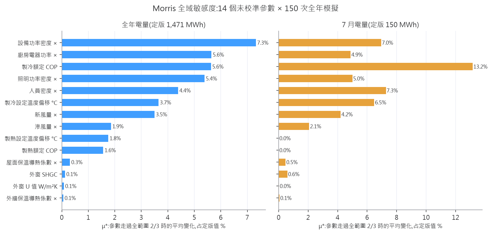
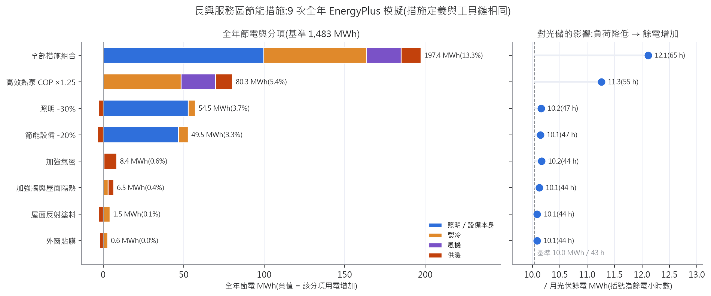
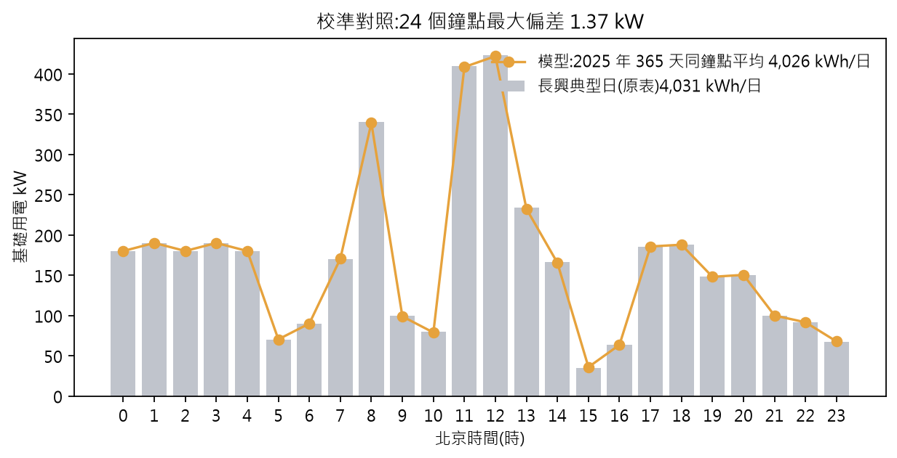

# 建築能耗模擬與校準工具鏈

[](https://github.com/Tanna-qne/building-energy-toolchain/actions/workflows/ci.yml)

**English summary: [SUMMARY_EN.md](SUMMARY_EN.md)** · **互動結果頁: [https://tanna-qne.github.io/building-energy-toolchain/](https://tanna-qne.github.io/building-energy-toolchain/)**(選任一天或一週看逐時負荷與光伏，附全年淨負荷熱圖)

以 EnergyPlus 為核心的建築能耗建模、校準與節能評估工作。包含一個完整的研究算例(長興高速服務區光儲充系統的負荷建模)，以及一套可重複使用的參數化建模與節能措施分析管線。

| 能力 | 本倉庫中的實作 |
|---|---|
| 建築能耗建模 | EnergyPlus 26.2、OpenStudio SDK、Ladybug Tools(honeybee-energy)；18 熱區綜合樓模型、PTHP 分體熱泵、Schedule:Compact 營業排程 |
| 模型校準與不確定性 | Morris 全域敏感度(150 次模擬)、4 折留出交叉驗證、100 組拉丁超立方抽樣並逐組重新校準的 5–95% 區間；依 ASHRAE Guideline 14 逐時指標：CV(RMSE) 0.06%、NMBE −0.04%(門檻 30% / ±10%)；以全年 365 天同鐘點均值對照實測典型日，迭代調整排程 |
| 氣象資料處理 | ECMWF ERA5 再分析(Open-Meteo API)→ EPW，可逐位元組重現；太陽幾何核對時間對齊 |
| 可再生能源與負荷序列 | 光伏：GHI 歸一化經驗情景 + NREL PVWatts v5 物理情景；充電：省級月度統計 × 實測日際波動的隨機情景 |
| 節能措施與經濟性 | 8 種 ECM 與組合、年省能/省錢、簡單回收期、電價與造價敏感度 |
| 自動化與重現性 | Python 管線、平行模擬(MCP server 池)、DesignBuilder dsbXML 生成與 MCP 控制、煙霧測試；GitHub Actions 每次 push 在 Linux 上重跑長興定版模型與 9 種節能措施，與倉庫結果比對；EnergyPlus 路徑自動偵測(或設 `ENERGYPLUS_DIR`)，不綁定特定電腦 |

## 代表作：長興服務區光儲充負荷建模

> [projects/changxing/MODEL_README.md](projects/changxing/MODEL_README.md)

**問題**：光儲充容量優化需要全年 8,760 小時負荷，但現場只有一條 24 點的年平均典型日。

**方法**
1. 以文獻原型(洪章飛 2024，合肥工業大學)建立兩層綜合樓 EnergyPlus 模型，圍護與室內參數按 DB34/5076、GB 50034 等標準取值，規模縮放至 5,048 m²。
2. 由 ERA5 產生 2025 年逐時 EPW，讓空調負荷隨真實氣象變化。
3. 校準：每輪跑完全年，以 365 天同鐘點均值對照典型日 24 點，殘差換算成營業強度、分攤負荷與站房支路三個校準量，3 輪收斂至最大偏差 0.27 kW。
4. 加入冬季熱泵供暖後，季節比例(夏 1.24、冬 1.06，相對過渡季)與 Ye 等(2025，*Energy* 340)的服務區實測(約 1.27、1.08)一致，作為校準以外的旁證。
5. 光伏與充電序列以同一原則構造(全年同鐘點均值約束回典型日)，三條序列按北京時間逐小時對齊，輸出 7 月 744 小時的調度輸入。

6. **Morris 全域敏感度**(14 個未校準參數、150 次全年模擬、10 進程平行)：建築由內部負荷主導，圍護結構對全年電量影響 ≤ 0.3%；7 月電量最敏感的是製冷 COP(μ* 13%)，供暖電量對新風、滲風、製熱設定與 COP 高度敏感(μ* 39–51%)，據此排定現場核實的優先順序。
7. **4 折留出驗證**：以 7 時段低自由度模型實際重跑 EnergyPlus，留出 CV(RMSE) 48%(純統計對照 53%)。結論是典型日的逐時形狀由運營決定、無法由物理推出，為定版採用 24 個逐時強度提供了定量依據，而不是過擬合。
8. **節能措施閉環**：把下方工具鏈的 8 種措施套用到定版模型(9 次全年模擬)。組合措施全年節電 192 MWh(13.0%)，排序與 Morris 結果一致：高效熱泵 > 照明 > 設備 ≫ 圍護。貼膜與反射塗料在夏熱冬冷地區冷熱抵消，淨節電接近 0；七項單獨節電合計比組合多 5.9 MWh(措施間交互)。節能後 7 月光伏餘電由 42 小時增至 65 小時，但淨負荷峰值只降 3.9%(峰值由充電主導)，因此儲能容量應以改造後負荷重新優化。
9. **變頻熱泵**：空調由單速 PTHP(開停機)換成 4 / 5 速變頻盤管並重新校準。額定 COP 不變，季節平均 COP 製冷 3.79 → 4.42、製熱 2.83 → 3.26，供暖 67 → 52 MWh。兩版校準後總量只差 0.1%，說明只有總量數據時空調效率無法辨識，校準只是把電量在分項間重新分配。
10. **不確定性區間**：14 個文獻參數拉丁超立方抽 100 組，每組各自重新校準到典型日(277 次全年模擬)。校準把全年電量的 5–95% 區間從 ±6.9% 收窄到 ±0.1%、7 月從 ±10.8% 收窄到 ±4.2%，但製冷(±22%)、供暖(±52%)幾乎沒有收窄。7 月光伏餘電 ±5.4%、淨負荷峰值 ±1.1%，儲能容量對建築參數不敏感。逐時區間顯示在互動結果頁。
11. **對照 GB 55015-2021**：按甲類公共建築逐項檢查。外牆、北／東／西窗符合；屋面 K 0.45(限值 0.40)、南窗 SHGC 0.40(限值 0.35)、遮陽、7 類房間的照明功率密度不符。附錄 C 權衡判斷不通過(64.44 對 64.23 kWh/m²)，但圍護改到限值只省 0.07%；照明降到限值省 2.8%。

**誠實揭露**：吻合度反映校準完成程度而非獨立驗證；所有假設與局限列於說明文件第 9、11–16 節。







## 參數化節能措施分析

輸入建築參數(尺寸、樓層、窗牆比、用途、空調系統)，自動生成 EnergyPlus 模型，跑基準與 8 種節能措施(照明、外窗隔熱膜、照明 + 貼膜、氣密、屋頂反射漆、節能設備、圍護隔熱、高效空調)，輸出省能、省錢與回收期報告。也可直接讀入 DesignBuilder 匯出的 IDF(自動升級 23.1 → 26.2)。

| 模組 | 說明 |
|---|---|
| [tools/modeler/build_idf.py](tools/modeler/build_idf.py) | 參數 → dragonfly 量體 → honeybee 負載/構造/HVAC → IDF |
| [scan2/](scan2/) | 措施與組合模擬、回收期；多個 MCP server 平行執行 |
| [sensitivity.py](sensitivity.py) | 電價與造價敏感度網頁 |
| [tools/designbuilder_mcp/](tools/designbuilder_mcp/) | DesignBuilder 的 MCP server(8 個工具：讀模型、改屬性、模擬、措施報告、由參數建模) |
| [tests/smoke.py](tests/smoke.py) | 端到端煙霧測試(建模、升級、措施、批量模擬) |

敏感度分析的公開成果另見 [building-energy-sensitivity](https://github.com/Tanna-qne/building-energy-sensitivity)。

## 使用方式

## 最簡單:裝好就用(只需要 DesignBuilder)

在裝了 DesignBuilder 的 Windows 電腦上:

1. 先裝 [uv](https://docs.astral.sh/uv/getting-started/installation/) 和 Git。
2. 雙擊根目錄的 **安裝.bat**。它會:
   - 用 **DesignBuilder 自帶的 EnergyPlus**(23.1)整理出 `tools/dbengine/engine/`,不另外下載 EnergyPlus。
     DB 只附引擎的 DLL,所以安裝程式用 Windows 內建的 C# 編譯器產生一個標準的 `energyplus.exe` 外殼
     ([energyplus_shim.cs](tools/dbengine/energyplus_shim.cs)),也代替 DB 沒附的 ReadVarsESO 輸出 CSV。
   - 建好建模環境(OpenStudio 3.6.1,對應 EnergyPlus 23.1)、EnergyPlus-MCP(固定版本 + [本機修正](tools/energyplus_mcp/energyplus-mcp.patch))、DesignBuilder MCP。
   - 詢問要不要把兩個 MCP server 加到 Claude Desktop、Claude Code、DeepSeek Harness(會先備份原設定)。
   - 最後自我檢查,並產生 **建築能耗.bat**。
3. 雙擊 **建築能耗.bat**:選 .dsb / .idf 模型,或填寬、深、層數、用途、空調,選氣象檔,按「開始計算」。
   算完會自動打開報告。也可以把模型檔拖到 建築能耗.bat 上。

說明:
- 用 DesignBuilder 的引擎跑 DB 匯出的模型,結果和官方 EnergyPlus 26.2 幾乎相同
  (範例模型全年用電 39,792 kWh 兩者一致,8 種措施的省能 % 相同)。
- 引擎是 23.1 版,沒有附升級程式:比 23.1 舊的 IDF 要從 DB 重新匯出;長興項目的模型是 26.2 版,仍用官方 EnergyPlus。
- 「選 .dsb」會啟動 DesignBuilder 跑模擬,需要 DB 授權;「選 .idf」和「填參數」只用引擎,不開 DB 視窗。
- 參數建模的設計日取自所選氣象檔(有 .ddy 用 .ddy,沒有就從 EPW 檔頭的 ASHRAE 設計條件推算)。

## 三步驟

1. 複製 `tools/modeler/example.json`,改成你的建築:

   ```json
   {
     "name": "demo_office",
     "shape": "rect",
     "width": 40, "depth": 25,
     "stories": 3, "floor_height": 3.6,
     "wwr": 0.4,
     "building_type": "MediumOffice",
     "climate_zone": 5,
     "construction": "SteelFramed",
     "hvac": "VAV_Chiller_Boiler"
   }
   ```

   L 形用 `"shape": "L"`,再加 `notch_width`、`notch_depth`(從右上角挖掉的大小)。
   `name`、`width`、`depth` 必填,其他不填就用上面的預設值;填錯會列出可用的選項。

2. 執行(用主 Python,它會自己呼叫建模工具的 venv):

   ```
   python run_building.py 你的檔案.json
   ```

   要比較幾個方案(例如不同空調、不同樓層數),一次給多個參數檔,每個的 `name` 要不同:

   ```
   python run_building.py 方案A.json 方案B.json 方案C.json
   ```

   報告最前面會多一段「方案比較」:哪個方案一年能源費用最低、費用長條圖與對照表。
   面積不同時改用每 m² 費用比較;總能源最少卻不是最省錢時,也會用一句話說明原因。

3. 用瀏覽器打開 `db_models/out/report.html`:最上面一句話告訴你哪個措施最划算,
   下面依序是一年用多少能源、每個措施一年省多少錢,以及「值得考慮 / 看情況 / 不太划算」的白話判讀。
   給工程師看的明細在同資料夾的 `report.md` 與 `results.csv`。

一棟 3 層、15 個 zone 的辦公大樓,從建模到跑完 5 個情境約 1–2 分鐘。

## 可選參數

| 參數 | 說明 | 例子 |
|---|---|---|
| `building_type` | DOE 標準建築用途,決定人員、照明、設備負載與作息 | `MediumOffice`、`Retail`、`SmallHotel`、`PrimarySchool` |
| `climate_zone` | ASHRAE 氣候區,決定牆、屋頂、窗的構造 | 1–8;目前氣象檔是 Chicago(5) |
| `construction` | 構造型式 | `SteelFramed`、`WoodFramed`、`Mass`、`Metal Building` |
| `hvac` | 空調系統 | `VAV_Chiller_Boiler`、`PSZAC_GasCoil`、`PTAC_ElectricBaseboard` 等 |
| `construction_vintage` | 牆、屋頂、窗構造的年代;舊建築改造填舊的 | `2019`(預設)、`1980_2004`、`pre_1980` |

## 貨幣與價格(`costs.json`)

報告的貨幣、電價、氣價與施工單價都在根目錄的 `costs.json`,預設美元:

```json
{"currency": "USD", "symbol": "US$", "price_per_kwh": 0.13, "gas_per_kwh": 0.04,
 "film_per_m2_glass": 40, "lighting_per_m2_floor": 20, "coolroof_per_m2_roof": 12,
 "insulation_per_m2_envelope": 45, "hvac_per_m2_floor": 90}
```

都是假設值。換成客戶當地的價格或其他貨幣,直接改這個檔再重跑;例如新台幣大約是
`"currency": "TWD", "symbol": "NT$", "price_per_kwh": 4.5, "gas_per_kwh": 1.5, "film_per_m2_glass": 1200,
"lighting_per_m2_floor": 600, "coolroof_per_m2_roof": 350, "insulation_per_m2_envelope": 1400, "hvac_per_m2_floor": 2800`。

## 也可以用 DesignBuilder 的模型

**最省事:DB 模擬跑完自動出報告**(設一次就好):

1. DB 工具列 **Scripts**(或 Tools → Scripts)打開 Script Manager,新增一個 C# script,
   把 `tools/designbuilder/AfterSimReport.cs` 整個貼進去,勾選啟用。
2. 之後照常在 **Simulation → Update data** 跑模擬。跑完約 3–10 分鐘,瀏覽器會自動打開節能措施報告
   (用和 DB 同一個氣象檔)。結果在 `db_models/from_db/<模型名>/`,出錯看同資料夾的 `run.log`。

**讓 agent 直接操作 DB**:`tools/designbuilder_mcp/` 是一個 MCP server(DSH 裡叫 `designbuilder`),
可以讀模型、改屬性、用 DB 跑模擬、算節能措施、由參數建 DB 模型。工具清單與注意事項見 `handover/HARNESS.md` §7。
工具回傳的是白話摘要:`db_status` 會顯示授權剩幾天;`db_simulate` 給全年用能、單位面積能耗、分項、用電峰值與溫度沒達標的時數
(同時寫一份 `summary.md` 在輸出資料夾);`db_report_status` 依「值不值得做」排好每個措施。
安裝:`uv venv tools/designbuilder_mcp/.venv --python 3.12`,再
`uv pip install --python tools/designbuilder_mcp/.venv/Scripts/python.exe -r tools/designbuilder_mcp/requirements.txt`。

**手動匯出**:

1. 在 DB 開啟模型,按工具列上的 **Export IDF model** 按鈕(File → Export 選單裡沒有 IDF)。
   檔案預設存到 `文件\DesignBuilder Data\`。
2. 把它複製到 `db_models/inbox/`,執行 `python db_import.py`,結果一樣在 `db_models/out/report.html`。

DB 2025 匯出的是 E+ 23.1 版,會自動升級到 26.2;中文檔名、評估版的壓縮格式都可以。
DB 預設的簡化空調是「理想負載」,只算出要供應多少冷 / 熱,報告會用假設效率換成用電與天然氣
(冷氣 COP 3、暖氣與熱水用瓦斯鍋爐 85%,在 `scan2/scan2.py` 的 `IDEAL_COOL_COP` / `IDEAL_HEAT_EFF`)。

## 這套工具怎麼組成

| 元件 | 角色 |
|---|---|
| [Ladybug Tools](https://www.ladybug.tools/)(dragonfly / honeybee-energy / honeybee-openstudio) | 由參數建出量體、負載、構造、空調,轉成 IDF |
| [OpenStudio SDK](https://openstudio.net/) 3.11 | honeybee 轉 IDF 時使用 |
| [LBNL EnergyPlus-MCP](https://github.com/LBNL-ETA/EnergyPlus-MCP) | 所有模型修改與模擬都透過它的工具 |
| EnergyPlus 26.2 | 模擬引擎 |

腳本:`tools/modeler/build_idf.py`(參數 → IDF;建完會說明建了什麼、哪些參數用了預設值,拼錯會提示正確名稱)、`db_import.py`(升級 → 補電表 → 跑措施)、
`scan2/scan2.py`(措施、組合、回收期,最多 4 個模擬平行)、`sensitivity.py`(電價 / 成本敏感度網頁)、
`tools/eplus_summary.py`(任何 EnergyPlus 的 `eplustbl.htm` → 中文摘要,公制英制都換成 kWh、kW、m²)。

```
python tools/eplus_summary.py <eplustbl.htm 或輸出資料夾>
```

## 檢查是不是都還能用

```
python tests/smoke.py
```

把所有重要功能實際跑一次(約 45 分鐘):參數建模(長方形 / L 形、三種空調)、參數填錯的提示、
舊版 IDF 升級與中文檔名、5 個範例模型的措施與敏感度網頁、11 個模型批量模擬、eppy 修正。
改過程式、`uv sync` 或升級 EnergyPlus 之後跑一次,全部 PASS 才算正常。

## 安裝(新機器)

- EnergyPlus 26.2、EnergyPlus-MCP 與 Windows 修正:見 `handover/HANDOVER.md` §5。
- 建模工具:

  ```
  uv venv tools/modeler/.venv --python 3.12
  uv pip install --python tools/modeler/.venv/Scripts/python.exe -r tools/modeler/requirements.txt
  ```

EnergyPlus 路徑由 [eplus_paths.py](eplus_paths.py) 自動尋找:環境變數 `ENERGYPLUS_DIR` → PATH 上的 `energyplus` → 各平台預設安裝位置
(Windows `C:\EnergyPlusV26-2-0` 或 `%LOCALAPPDATA%\Programs\EnergyPlusV26-2-0\*`、Linux `/usr/local/EnergyPlus-26-2-0`、macOS `/Applications/EnergyPlus-26-2-0`)。
DesignBuilder MCP 跑節能報告用的 Python 可用 `REPORT_PYTHON` 指定。

不需 MCP server 的重現性檢查(CI 跑的就是這個):

```
uv run --with eppy python tests/ci_check.py
```

## 限制

- 只支援方形與 L 形;複雜造型請用 DesignBuilder 建模後匯出。
- 氣象檔固定 Chicago;成本(電價、氣價、貼膜、燈具)是假設值,在 `scan2/scan2.py` 的 `COSTS`。
- 照明 −30%、滲風 ×0.5、設備 −20% 是固定比例;貼膜會依原窗調整(只降 SHGC、U 值不變,原窗已經能遮陽就不貼);
  屋頂反射漆把屋頂日射吸收率改成 0.3(原本已經是淺色就不做)。
- 「加強隔熱」:參數模型換成較新 / 較冷氣候區的保溫規範;DesignBuilder 等 IDF 在原構造加一層保溫到外牆 U 0.25、屋頂 0.18。
- 「換高效率空調」:冰水主機與冷氣 COP ×1.25、鍋爐 95%、風扇 0.7;理想負載模型改用換算效率。

## 授權

Ladybug Tools 套件是 AGPL-3.0,OpenStudio 是 BSD-3。本 repo 只透過 pip 使用它們,不含其原始碼。
