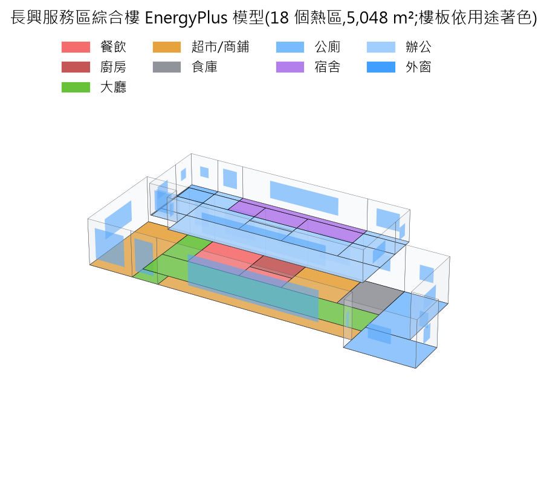
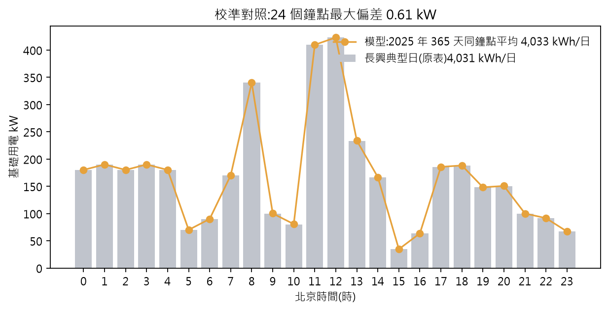
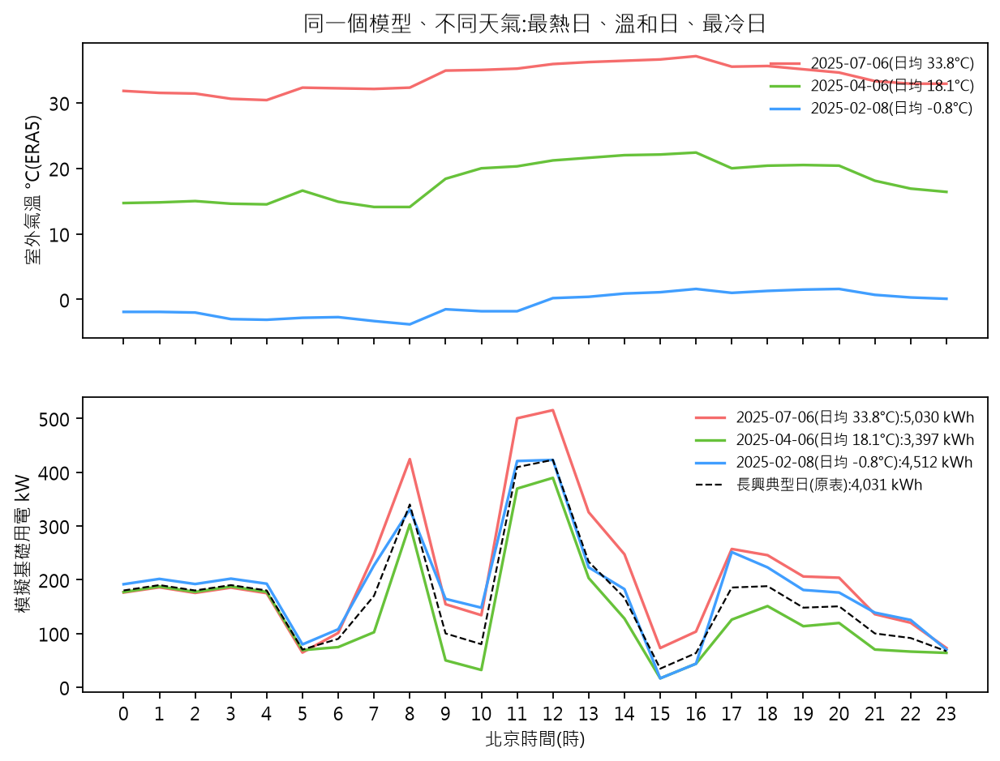

# 长兴服务区综合楼基础用电：EnergyPlus 模拟模型说明

本说明介绍长兴服务区“服务区基础侧负荷”2025 年逐时序列的来源。该序列由建筑能耗模拟软件 EnergyPlus 计算得到。建筑模型以文献中的服务区综合楼为原型，输入长兴的规模、2025 年逐时实测再分析气象，并以通讯作者提供的长兴典型日 24 点负荷为基准校准。

全年 8,760 小时中，只有典型日的 24 个钟点有实测依据，其余逐时数值都是模型计算结果。因此本序列应称为**校准后的逐时模拟情景**，不应视为实测数据。第 9 节列出模型的局限。



---

## 1 研究范围

| 序列 | 计算方法 | 说明 |
|---|---|---|
| **基础用电**(本说明) | EnergyPlus 26.2 建筑能耗模拟 | 综合楼照明、插座与营业设备、厨房、空调、通风，以及按估算单独计量的附属支路 |
| 光伏出力 | 以逐时水平总辐射对典型日进行归一化缩放；另有一组依 NREL PVWatts v5 关系式的物理情景 | 不使用 EnergyPlus，见 [pv_2025/README.md](pv_2025/README.md)、[pv_2025/unit_capacity/README.md](pv_2025/unit_capacity/README.md) |
| 车辆充电 | 典型日 × 浙江省月度系数 × 日际波动系数 | 不使用 EnergyPlus，见 [charging_2025/README.md](charging_2025/README.md)、[charging_inputs/README.md](charging_inputs/README.md) |

三条序列按北京时间逐小时对齐后合并，见 [README.md](README.md)。

## 2 计算工具

**EnergyPlus**([官网](https://energyplus.net/)、[源代码](https://github.com/NREL/EnergyPlus))由美国能源部(DOE)建筑技术办公室资助，美国国家可再生能源实验室(NREL)等机构开发维护，开源免费。

- 它是建筑整体能耗模拟的通用计算引擎：常用的 DesignBuilder、OpenStudio 等软件，其能耗计算都调用 EnergyPlus。
- 美国的建筑节能标准评估和绿色建筑评价普遍采用它进行能耗计算。
- 软件按 ANSI/ASHRAE Standard 140(建筑能耗分析软件测试方法)进行测试。

本模型使用 **EnergyPlus 26.2**。模拟逻辑完全由 EnergyPlus 完成，未自行编写传热或空调计算。

建立几何与初始参数时，使用了 Ladybug Tools 的 [honeybee-energy](https://www.ladybug.tools/) 与美国 NREL 的 [OpenStudio SDK](https://openstudio.net/) 生成 EnergyPlus 输入文件(IDF)。最终模型即 IDF 文件本身，可直接用 EnergyPlus 运行。

## 3 输入数据与来源

| 输入 | 内容 | 来源 | 文件 |
|---|---|---|---|
| 建筑原型 | 两层综合楼平面：一层为公厕、大厅、超市、餐厅、厨房、食库、特产售卖；二层为办公与宿舍 | 洪章飞.《低碳视角下安徽省高速公路服务区建筑设计策略研究》[D]. 合肥工业大学，2024. 案例服务区：第 4.3.2 节(第 44 页);一层、二层平面：图 4.16、4.17(第 45 页) | [cx_lowest_max.idf](cx_lowest_max.idf) |
| 规模 | 等效总建筑面积 5,048 m²，分区面积按原型平面比例缩放 | 长兴服务区 2017 年公开资料 | 同上 |
| 围护结构 | 外墙：60 mm 匀质防火保温板 + 200 mm 加气混凝土砌块；坡屋面：50 mm 硬泡聚氨酯；外窗：铝合金框 6Low-E+12A+6 | 洪章飞论文 表 4.5(第 52–53 页)、表 5.9(第 87 页) | 同上 |
| 室内参数 | 各功能区的人员密度、照明功率、设备功率、新风量、空调设定温度与启停时间 | 洪章飞论文 表 4.6、表 4.7(第 54 页)，其依据为 DB34/5076-2017、GB 50034-2013、JGJ 48、JGJ 64、JGJ 67 等设计标准 | 同上 |
| 气象 | 2025 年 1 月 1 日至 12 月 31 日逐时气温、湿度、气压、风速风向、云量、水平总辐射、法向直射与散射辐射 | 欧洲中期天气预报中心(ECMWF)[ERA5 再分析](https://www.ecmwf.int/en/forecasts/dataset/ecmwf-reanalysis-v5)，经 [Open-Meteo 历史气象 API](https://open-meteo.com/en/docs/historical-weather-api) 取 31.00°N、120.00°E 网格 | [weather/](weather/) |
| 校准基准 | 长兴服务区典型日 0–23 时基础侧负荷，日合计 4,031 kWh | 通讯作者提供的长兴原表，对应 Lin F, Shi R, et al. *Energy*, 2026, 361: 141962([doi](https://doi.org/10.1016/j.energy.2026.141962) · [全文](references/Lin_dual_transformer_PV_storage_charging.pdf))。该文第 6.1 节(第 9 页)说明：基础侧负荷包括照明、空调、餐饮、办公及其他辅助负荷，与充电侧由不同变压器供电；典型日由全年历史数据按 24 个钟点平均得到 | [calibration_24h.csv](calibration_24h.csv) |
| 营业排程 | 逐时营业强度、附属支路系数 | 以上述 24 点校准得到 | [schedules.csv](schedules.csv) |

**气象文件可从原始数据完整重现**:
- [weather/source/](weather/source/) 中保存 Open-Meteo 原始下载 CSV。
- [weather/make_epw.py](weather/make_epw.py) 将其转为 EnergyPlus 气象文件(EPW)，重新转换的结果与仓库中的 EPW 逐字节一致。
- 转换要点：风速 km/h ÷ 3.6;气压 hPa × 100;辐射按“时间戳前一小时平均”对齐到 EPW 同一小时。
- 抽查太阳几何，GHI 与 DNI·cosθz + DHI 相差约 1 W/m²，说明时间对齐正确。
- 12 月 31 日最后一小时所需的 2026-01-01 00:00 记录，以相同 API 配置补取。补取前已验证，同一配置下 2025-07-01 至 12-31 共 4,416 小时与原始 CSV 完全一致。

## 4 建筑模型

模型共 18 个热区，空调区 13 个。建筑主轴北偏西 20.6°(按原型平面图指北针)，主立面朝南偏东约 20°。首层层高 5.9 m、二层 4.0 m(取洪章飞论文第 5.3 节(第 82 页)“首层 5.6–6.2 m、二层 3.9–4.2 m”的中值)。

空调全年可用，制冷或制热由表 4.6 的设定温度决定(夏季 25–26 °C、冬季 20–22 °C)，室温在两者之间时不运行。5–9 月的每日可用时段见下表；其余月份使用同样时段，但每天 15–17 时停机(校准假设，见第 9 节第 6 条)：

| 楼层 | 功能区 | 面积 m² | 人员 人/m² | 照明 W/m² | 设备 W/m² | 7 月空调可用时段 |
|---|---|---:|---:|---:|---:|---|
| 一层 | 超市(西翼) | 443.4 | 0.66 | 10 | 13 | 07–15、17–23 时 |
| 一层 | 特产/便利(北) | 267.5 | 0.66 | 10 | 13 | 07–23 时 |
| 一层 | 特产售卖(南) | 340.3 | 0.66 | 10 | 13 | 07–15、17–23 时 |
| 一层 | 大厅通廊及楼梯厅(3 区) | 889.8 | 0.62 | 9 | 10 | 07–15、17–23 时 |
| 一层 | 餐饮区(2 区) | 340.9 | 0.45 | 10 | 13 | 06–23 时 |
| 一层 | 厨房 | 123.9 | 0.10 | 10 | 厨房电器 400、排油烟 22 | 不设空调 |
| 一层 | 食库及后勤 | 199.1 | 0.02 | 5 | 30(冷藏) | 不设空调 |
| 一层 | 公厕(2 区) | 581.0 | 0.20 | 10 | 排风 11.8 | 不设空调(表 4.6) |
| 二层 | 办公(4 区) | 1,448.7 | 0.12 | 9 | 15 | 07–19 时 |
| 二层 | 公寓宿舍 | 338.5 | 0.07 | 7 | 20 | 00–08、18–24 时 |
| 二层 | 卫生间及楼梯 | 74.8 | 0.20 | 10 | 排风 8.0 | 不设空调 |

- 人员、照明、设备密度取自洪章飞论文表 4.7;空调设定温度与启停时间取自表 4.6(均在第 54 页)。
- 各区另设一项按面积分摊的校准负荷(79.2 W/m²,按 `eq_bus` 排程运行，主要出现在 8 时、11–12 时)，用于表示典型日用餐高峰中模型其他分项未能覆盖的部分。
- 空调采用分体式热泵(洪章飞论文第 4.4.2 节第 55 页：“采用分体式空调方案”),以 EnergyPlus 的 PTHP 模型计算压缩机和风机电耗，额定制冷 COP 3.5。

## 5 计算过程

EnergyPlus 以 15 分钟为步长，逐时求解每个热区的热平衡：
- 依当时的室外气温与太阳辐射，计算墙、屋顶、外窗的传热和得热；
- 加上人员、照明、设备的内部得热；
- 由空调模型计算维持设定温度所需的冷热量，以及对应的压缩机与风机耗电；
- 照明、设备和厨房的耗电，则按功率密度乘以当时的营业排程计算。

全年连续计算 8,760 小时，输出各分项的逐时电表。时间采用北京时间(UTC+8)，每行对应一个小时区间(`interval_start` 至 `interval_end`)。

## 6 校准

将全年 365 天同一钟点的模拟负荷取平均，与长兴典型日的 24 点逐一比较。



| 指标 | 结果 | 参考 |
|---|---:|---|
| 日用电量 | 模拟 4,033 kWh / 原表 4,031 kWh(+0.05%) | — |
| 逐钟点最大绝对偏差 | 0.61 kW | — |
| CV(RMSE) | 0.10% | ASHRAE Guideline 14 逐时校准要求 ≤ 30% |
| NMBE | +0.06% | ASHRAE Guideline 14 逐时校准要求 ±10% 以内 |

营业排程与分摊负荷就是用这 24 点调整得到的，所以以上吻合度反映的是**校准完成的程度**，不是独立验证。模型在校准之外提供的信息，是第 7 节所示、由气象驱动的逐日变化。

## 7 全年逐时序列为何连续变化

模型中营业排程每天相同，日与日之间的差别来自 2025 年逐时气象，主要体现为空调用电。下图比较同一模型在 2025 年最热日、日均气温最接近 18 °C 的日子和最冷日的计算结果：



| 日期 | 日均气温 | 模拟日用电 |
|---|---:|---:|
| 2025-07-06(最热日) | 33.8 °C | 5,030 kWh |
| 2025-04-06(温和日) | 18.1 °C | 3,397 kWh |
| 2025-02-08(最冷日) | −0.8 °C | 4,512 kWh |
| 长兴典型日(原表) | — | 4,031 kWh |

- 逐时序列的连续性来自气象数据本身的连续性：气温与日照逐小时变化，空调负荷随之变化。
- 营业相关的用电(照明、设备、厨房)在不同日期保持相同形状。
- 最冷日高于温和日，差额主要是热泵供暖用电；全年供暖用电合计约 67,239 kWh。
- 季节差异与实测服务区的规律一致：本模型夏季(6–8 月)、冬季(12–2 月)日均负荷分别为过渡季的 1.25 倍和 1.06 倍；Ye 等(2025)新疆服务区 2022–2024 年逐时实测的基础负荷，读图 7(第 13 页)约为 1.27 倍和 1.08 倍([全文](references/Ye2025_multistage_stochastic_robust_planning_Energy340.pdf))。两地气候不同，此处只作量级旁证。

## 8 结果文件

| 文件 | 内容 |
|---|---|
| [hourly_2025.csv](hourly_2025.csv) | 2025 年 8,760 小时逐时用电(kWh)。`comparison_kWh` 为与长兴原表同口径的基础侧负荷；`station_total_kWh` 为全站电表(另含单独计量的附属支路 `ancillary7_kWh`) |
| [hourly_2025_07.csv](hourly_2025_07.csv) | 其中 7 月连续 744 小时 |
| [calibration_24h.csv](calibration_24h.csv) | 全年同钟点均值与原表 24 点对照 |

2025 年全年基础侧负荷(`comparison_kWh`)合计 1,472,101 kWh。7 月合计 149,886 kWh,最大小时出现在 7 月 16 日 12–13 时，为 520.9 kWh。

## 9 局限与使用说明

1. **实测依据只有一个典型日**:校准仅用 24 个钟点。模拟序列中日与日之间的差异(气象驱动)缺少长兴同期月度或逐时电表的独立验证。
2. **营业排程每天相同**:未区分工作日、周末与节假日，也未考虑车流的季节变化。客流引起的日际差异未体现在本序列中。
3. **建筑为文献原型**:几何与围护来自安徽阜阳案例服务区，规模按长兴面积等比缩放，并非长兴综合楼实测图纸。
4. **气象为再分析网格值**:ERA5 网格(31.00°N、120.00°E)与服务区实际位置存在距离，局地小气候差异未计入。
5. **分摊校准负荷为等效处理**:79.2 W/m² 的分摊负荷用于复现典型日高峰，并不对应某一具体设备。
6. **非夏季午后停机为校准假设**:原表 15 时仅 34.5 kW，为全天低谷。加入冬季供暖后，若空调在 15–17 时照常运行，营业排程降至零仍高出约 10 kW。模型因此设定 10–4 月空调每天 15–17 时停机，与 5–9 月商业区的午后时段一致。该假设无文献或现场依据。

## 10 复现方法

1. 安装 [EnergyPlus 26.2](https://energyplus.net/downloads)(免费)。
2. 在本目录执行：

   ```
   energyplus -w weather/CHN_Changxing_ERA5_31.00N_120.00E_2025.epw -r cx_lowest_max.idf
   ```

   输出的逐时电表 `Electricity:Facility` 与 `hourly_2025.csv` 的 `station_total_kWh` 逐小时一致(2026-11-20 重跑，8,760 小时最大差 0.0 kWh)。
3. 从原始气象重建 EPW:`python weather/make_epw.py`。
4. 重新生成本说明的插图：`uv run --with matplotlib python docs/make_figures.py`。

模型文件为文本格式的 EnergyPlus 输入文件，可用 EnergyPlus 自带的 IDF Editor 或 OpenStudio Application 打开查看几何与参数。

## 11 光伏与充电序列的构造

两条序列不使用 EnergyPlus。它们与基础用电共用同一套原则：长兴原表 24 点视为全年同钟点均值(Lin 等 2026 第 6.1 节)，用外部数据决定“不同日期的同一钟点”如何变化，再约束全年同钟点均值回到原表。

### 11.1 光伏

$$PV(d,h) = P_{ref}(h)\times 1\,\text{h}\times\frac{GHI(d,h)}{\overline{GHI}(h)}$$

- $P_{ref}(h)$：长兴原表“光伏出力”第 $h$ 钟点；$GHI(d,h)$：第 3 节同一份 ERA5 气象中该日该小时的水平总辐射；$\overline{GHI}(h)$：全年 365 天同钟点平均。
- 晴天出力高于平均、阴雨天低于平均，全年同钟点均值严格等于原表。原表为零的钟点固定为零。
- 另有一组物理情景，按 [NREL PVWatts v5 技术手册](https://pvwatts.nrel.gov/downloads/pvwattsv5.pdf) 的倾斜面辐照、电池片温度与系统损失关系计算单位装机出力，用于容量变化的情景。参数与结果见 [pv_2025/unit_capacity/README.md](pv_2025/unit_capacity/README.md)。
- 局限：经验情景未单独计入组件温度、遮挡与逆变器限幅；缺少长兴光伏月电量的独立验证。

脚本：[pv_2025/simulate.mjs](pv_2025/simulate.mjs) · 结果：[pv_2025/pv_hourly_2025.csv](pv_2025/pv_hourly_2025.csv)

### 11.2 车辆充电

$$E(d,h) = P_{ref}(h)\times 1\,\text{h}\times k_{月}(m)\times\frac{s(d)}{\overline{s}_m}$$

| 因子 | 含义 | 来源 |
|---|---|---|
| $P_{ref}(h)$ | 长兴原表充电列第 $h$ 钟点 | 通讯作者提供，[charging_inputs/changxing_reference_24h.csv](charging_inputs/changxing_reference_24h.csv) |
| $k_{月}(m)$ | 该月日均电量 ÷ 全年日均电量 | 《浙江省充换电基础设施发展报告(2022 年度)》图 3-5，全省高速公路服务区快充站月电量([报告 PDF](https://zjjcmspublic.oss-cn-hangzhou-zwynet-d01-a.internet.cloud.zj.gov.cn/jcms1/web3185/site/attach/0/b09089e65504409db3353586c54918ca.pdf))，[zhejiang_monthly.csv](charging_inputs/zhejiang_monthly.csv) |
| $s(d)$ | 日际相对波动，按工作日 / 周末分组有放回抽样，固定种子 20250701 | 深圳 UrbanEV 公开数据集 2022-09 至 2023-02 共 181 天([Dryad](https://datadryad.org/dataset/doi%3A10.5061/dryad.np5hqc04z))，[shenzhen_daily_variation.csv](charging_inputs/shenzhen_daily_variation.csv) |
| $\overline{s}_m$ | 该月抽样均值，使月系数保持为 $k_{月}(m)$ | — |

2025 年各月系数 $k_{月}$：1 月 0.75、2 月 0.88、3 月 0.49、4 月 0.37、5 月 0.54、6 月 0.90、7 月 1.26、8 月 1.28、9 月 1.29、10 月 1.52、11 月 1.26、12 月 1.45。

局限(与光伏相比，充电序列的外部依据更弱)：
1. 月度结构来自 2022 年浙江全省统计，不是长兴单站数据。2022 年全省快充设施仍在快速投运，下半年月电量偏高，其中一部分是设施增长而非季节需求。
2. 日际波动来自深圳城市充电汇总数据，不是高速服务区；空间汇总会平滑单站起伏。
3. 同一天内的形状固定为原表曲线，未模拟逐车到达、节假日出行高峰与排队。
4. 全年同钟点均值复现原表是归一化的结果，不构成验证。

因此，充电序列宜表述为“以长兴典型日为基准、引入省级季节结构与城市日际波动的情景”，并在优化中配合敏感性分析(例如以 $k_{月}\equiv1$ 的无季节情景对照)。

脚本：[charging_2025/simulate.py](charging_2025/simulate.py) · 结果：[charging_2025/charging_hourly_2025.csv](charging_2025/charging_hourly_2025.csv) · [各月电量](charging_2025/charging_monthly.csv)

## 参考文献

相关论文的引用与全文见 [references/](references/README.md)。
